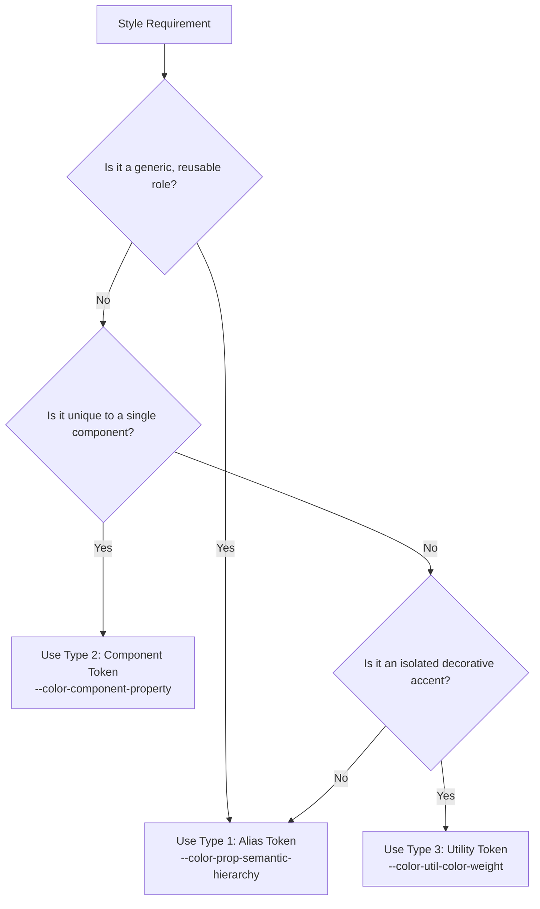

# Color System & Design Token Specification

This document defines the formal taxonomy, naming conventions, and architectural hierarchy for the project's color design tokens.

---

## 1. Architectural Overview

The color system is organized into a tiered token architecture to ensure consistency, theme adaptability, and clean separation of concerns:

```
┌────────────────────────────────────────────────────────┐
│  Primitive Tokens                                      │
│  Base color scales (e.g., --color-[name]-[weight])     │
└──────────────────────────┬─────────────────────────────┘
                           │ (abstracted into)
                           ▼
┌────────────────────────────────────────────────────────┐
│  Semantic Tokens                                       │
│  ├─ 1. Alias Tokens     (--color-[prop]-[sem]-[hier])  │
│  ├─ 2. Component Tokens (--color-[comp]-[prop]_[mod])  │
│  └─ 3. Utility Tokens   (--color-util-[color]-[weight])│
└──────────────────────────┬─────────────────────────────┘
                           │ (consumed by)
                           ▼
┌────────────────────────────────────────────────────────┐
│  UI Components & Features                              │
└────────────────────────────────────────────────────────┘
```

* **Primitive Layer:** Raw color values organized by hue family and numeric weights. Serves as the single source of color truth.
* **Semantic Layer:** Context-aware design tokens communicating intent, function, hierarchy, and state.
* **Strict Resolution Rule:** **All semantic token values must resolve directly to one of the primitive colors.** Semantic tokens should never contain raw, unmanaged hex or rgb values.

---

## 2. Primitive Color Tokens

### A. Naming Convention
Primitive tokens represent the underlying raw palette without semantic context:

```css
--color-[color-name]-[weight]
```

* **`[color-name]`**: The descriptive hue or neutral name (e.g., `neutral`, `blue`, `pink`, `green`, etc.).
* **`[weight]`**: The numeric shade step representing relative lightness, typically scaled from `100` (lightest / near-white tint) to `950` (deepest / near-black tone).

### B. Palette Sources
Primitive palettes can be established in one of two ways:
1. **Custom Crafted:** Manually tailored hue ramps with calibrated perceptual lightness steps.
2. **Established Systems:** Sourced from standardized, battle-tested palettes such as Tailwind CSS, Radix Colors, or Open Color.

---

## 3. Core Semantic Taxonomy & Dimensions

Every semantic token is composed from four foundational dimensions:

### A. Property (`[property]`)
Defines the physical CSS rendering target:
* **`bg`** *(Background):* Surface or container backgrounds that can host child elements (cards, containers, modals, button backgrounds).
* **`fg`** *(Foreground):* Visual shapes and non-text elements that **do not** contain children (icons, progress bar indicators, SVG shapes, decorative marks).
* **`text`** *(Typography):* Text and font colors.
* **`border`** *(Strokes & Dividers):* Borders, outlines, rules, and dividers.

### B. Semantic (`[semantic]`)
Defines the functional meaning or purpose of the color:
* **Status / Feedback:** `success`, `warning`, `error`, `info`.
* **Identity / Brand:** `brand`, `accent`.
* **Neutral (Default):** When the semantic slot is omitted, the token is implicitly **Neutral**.

### C. Hierarchy (`[hierarchy]`)
Denotes visual prominence and priority:
* **Standard Tiers:** `primary`, `secondary`, `tertiary`.
* **Extended Tiers (Special Cases):**
  * `solid`: Invariant neutral tones designed to remain bold across light/dark mode shifts (e.g., persistent dark accents).

### D. Modifier (`_[modifier]`)
Specifies dynamic interaction states or layout variations. Always preceded by an underscore (`_`):
* **Interaction States:** `_hover`, `_focus`, `_active`, `_disabled`.
* **Structural Variants:** `_alt`.

---

## 4. Semantic Token Classifications

### Type 1: Alias Tokens (Primary Workhorse)
Generic, reusable rules that form the backbone of the application's UI.

#### Pattern:
```css
--color-[property]-[semantic]-[hierarchy]_[modifier]
```

#### Syntax Rules:
1. **Modifier is Optional:** Only append `_[modifier]` when an explicit state or variant exists.
   * *Example:* `--color-bg-brand-primary` (resting) vs. `--color-bg-brand-primary_hover` (hover).
2. **Neutral Omission:** If the `[semantic]` segment is omitted, it explicitly represents the **Neutral** color scale.
   * *Example:* `--color-text-primary` $\rightarrow$ Primary neutral text.
   * *Example:* `--color-border-secondary` $\rightarrow$ Secondary neutral border.
3. **Hierarchy Extension:** For specialized invariant cases, hierarchy can use `solid`.
   * *Example:* `--color-bg-primary-solid` $\rightarrow$ Neutral background that stays dark regardless of theme.
4. **Hierarchy Omission:** Hierarchy may be omitted when only one unambiguous variant exists.
   * *Example:* `--color-fg-solid` $\rightarrow$ Shape foreground with singular prominence.

---

### Type 2: Component Tokens
Specialized tokens dedicated to a specific component when its styling cannot be mapped cleanly to generic alias tokens.

#### Pattern:
```css
--color-[component]-[property]_[modifier]
--color-[component]-[element]-[property]_[modifier]
```

#### Examples:
* `--color-tooltip-bg` $\rightarrow$ Background dedicated to tooltip containers.
* `--color-rating-star-fg` $\rightarrow$ Specific foreground color for rating star icons.
* `--color-button-bg-primary_hover` $\rightarrow$ Specific primary button hover surface.

---

### Type 3: Utility Tokens (Proxy Tokens)
Controlled bridges that expose a primitive tone for isolated visual accents (e.g., checklist badges, metric highlight cards) without directly leaking raw primitives or hex values into feature CSS modules.

#### Pattern:
```css
--color-util-[color-name]-[weight]
```

#### Examples:
* `--color-util-blue-100` $\rightarrow$ Soft blue tint for informational tags.
* `--color-util-orange-500` $\rightarrow$ Vibrant orange accent for metric badges.

---

## 5. Agent Workflow & Interaction Protocol

When working on color tokens or component styles, the agent must adhere to the following operational procedure:

1. **Check Existing Primitives First:**
   * Always inspect [`src/styles/palette.css`](file:///d:/Project/Portfolio/src/styles/palette.css) to check which primitive colors and shade weights currently exist in the codebase.
2. **Resolve Missing Primitives with the User:**
   * If a required color family or weight does not exist, the agent must **not** invent arbitrary hex codes or introduce disconnected tokens.
   * The agent must pause and ask the user whether to:
     * Generate a new primitive color scale (custom or sourced from a standard palette like Tailwind), or
     * Map the requirement to an already existing primitive color.
3. **Brand Color Declaration:**
   * In either scenario, the user must explicitly declare the brand colors: either to be created as a new primitive palette scale or selected from already existing primitive colors.
4. **Enforce Semantic Derivation:**
   * Ensure newly created semantic tokens map strictly to an underlying primitive token variable (e.g., `var(--color-[name]-[weight])`).

---

## 6. Decision Matrix: Choosing the Right Token



---

## 7. Token Formatting & Syntax Standards

1. **Lowercase & Hyphenated:** All token identifiers use lowercase alphanumeric characters with hyphens separating segments.
2. **Underscore for Modifiers:** State and variant modifiers use an underscore (`_`) delimiter to distinguish them from taxonomic segments.
3. **Tabular Column Alignment (File Convention):**
   - In `palette.css`, all token values (hex codes, `var()` references, `rgba()` values, etc.) must align in the **exact same vertical column (Column 41 / index 40)**.
   - Use space padding after the colon rather than tabs, guaranteeing identical alignment across all editors and viewers regardless of individual `tabSize` settings:
   ```css
   --color-black:                        #000000;
   --color-neutral-100:                  #f5f5f5;
   --color-bg-brand-primary:             var(--color-blue-500);
   --color-border-brand-primary_hover:   var(--color-blue-600);
   ```
4. **Single Source of Truth:** All tokens must be declared in [`src/styles/palette.css`](file:///d:/Project/Portfolio/src/styles/palette.css).
